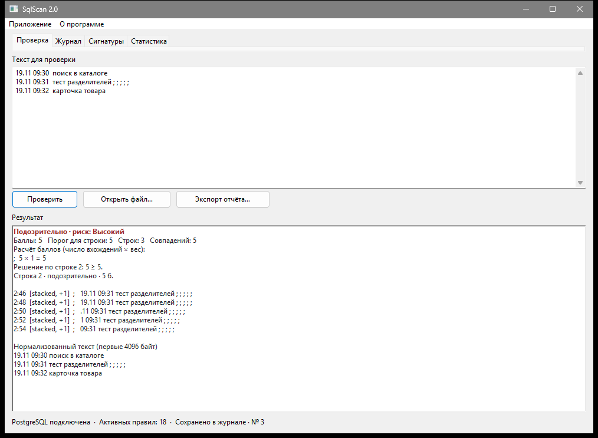

# Протокол испытаний SqlScan 2.0

19 ноября 2026 года, Windows x64. Проверена локальная Release-сборка C++20/MFC, MSVC 14.52, Windows SDK 10.0.26100.0. Исполняемый файл включает статические MFC и CRT, обе миграции PostgreSQL и манифест Windows Common Controls. Для полного комплекта использованы PostgreSQL 17.12 x64 и psqlODBC Unicode 18.00.0006.

**SHA-256 SqlScan.exe** — `3a1edbacd210c355b5aaf149653c122d9418475f16e7a966f37cb604daba51af`.

## Функциональные проверки

| Область | Сценарий | Результат |
|---|---|---|
| Схема | Создание от роли приложения, обновление базы с данными первой версии, повторное выполнение, ограничения, исторические веса, каскад | SQL-тест завершился откатом тестовой транзакции |
| Движок | Порог для отдельной строки, CRLF, позиции, числовые HTML-сущности, два прохода URL-декодирования, пробелы, граница между строками | Пройдены проверки нативного набора |
| Файлы и экспорт | BOM, NUL, хеш, лимит входа, ограничение подробностей с сохранением полной суммы, экранирование HTML и CSV | Пройдены проверки нативного набора |
| ODBC | Добавление и отключение правила, перечитывание, SHA-256, запрет удаления используемого правила, сохранность веса при изменении и каскад удаления | Пройдены проверки на PostgreSQL |
| Атомарность | Подставлен несуществующий ID правила при записи совпадения после вставки сводки | Число записей в журнале осталось прежним |
| GUI | Добавление и изменение правила, загрузка файла UTF-8, ручной ввод, повтор файла и открытие его прежнего отчёта, просмотр статистики | Пройден сценарий через контролы собранного EXE |
| Журнал и редактор | Фильтрация по имени файла, открытие сканирования, удаление с подтверждением, отключение сигнатуры и удаление освободившегося правила | Пройден сценарий через контролы окна |
| Экспорт GUI | Отчёт в TXT, CSV, HTML; историческая запись в HTML; отфильтрованный журнал в CSV | Файлы открыты программной проверкой, содержимое сопоставлено с исходной записью |
| Пакетный режим | Пути с кириллицей, запятые, кавычки, многострочные и пустые поля, неверные аргументы и CSV | Правильные коды выхода, при ошибке прежний файл результата сохранён |
| Сбой сервера | Сервер остановлен во время работы, выполнена новая проверка; затем сервер запущен снова | Автономный отчёт доступен, следующая проверка сохранилась после восстановления связи |
| Настройки | Прямой автономный запуск, подключение через диалог, запись DPAPI, закрытие и повторный запуск EXE, возврат в автономный режим | Строка соединения восстановлена новым процессом; поле реестра содержит шифротекст и удаляется при сбросе |
| Комплект | Запуск через командный файл из каталога с кириллицей и пробелом, запись проверки, остановка и перезапуск локального сервера | После повторного запуска запись открылась в журнале |

Microsoft Native Unit Test запускался через VSTest 18.7 x64. Обе группы прошли: `TextAnalysisAndReports` и `PostgreSqlRepository`. Отдельная консольная программа запускает те же проверки без Visual Studio Test Explorer.



## Время выполнения

Контрольный прогон на локальном PostgreSQL 17.12. В тестовом журнале предварительно созданы 10 000 записей. Показания — время отдельных операций по монотонным часам с округлением вниз до миллисекунды; запуск приложения, сервера и первичная установка измеряются отдельно от этих операций.

| Операция | Условие ТЗ | Контрольный результат |
|---|---:|---:|
| Анализ 512 КиБ текста без совпадений, штатные 18 правил | ≤ 100 мс | 1 мс |
| Создание проверки и сохранение 1 000 совпадений одной транзакцией | ≤ 1 000 мс | 17 мс |
| Чтение первой страницы из 50 записей при журнале на 10 000 проверок | ≤ 1 000 мс | < 1 мс |

Это измерения движка и репозитория при локальном соединении. Время перерисовки окна и сетевого подключения сюда не входит.

## Качество обнаружения

Для каждого набора версия 1.0, версия 2.0 и libinjection 4.0.2 получили одинаковый порядок записей. Встроенные сигнатуры и порог 5 зафиксированы в сборке. Режим `--legacy` дополнительно сверили с отдельно скомпилированным неизменённым `SqlInjectionDetector.cpp` из тега `v1.0`. Баллы и вердикты совпали для всех 40 970 записей двух наборов и девяти файлов проекта. При обычном построчном анализе 2.0 вердикты для девяти файлов сохранились; у `hidden_injection_long_query.sql` балл изменился с 29 до 26, потому что шаблон раньше совпадал через границу строк.

| Набор и движок | TP | FP | TN | FN | Precision | Recall | FPR | F1 |
|---|---:|---:|---:|---:|---:|---:|---:|---:|
| HttpParams · SqlScan 1.0 | 2 028 | 1 | 6 433 | 1 589 | 0,9995 | 0,5607 | 0,0002 | 0,7184 |
| HttpParams · SqlScan 2.0 | 2 028 | 1 | 6 433 | 1 589 | 0,9995 | 0,5607 | 0,0002 | 0,7184 |
| HttpParams · libinjection | 3 504 | 0 | 6 434 | 113 | 1,0000 | 0,9688 | 0,0000 | 0,9841 |
| Kaggle · SqlScan 1.0 | 4 509 | 594 | 18 943 | 6 873 | 0,8836 | 0,3962 | 0,0304 | 0,5470 |
| Kaggle · SqlScan 2.0 | 4 512 | 596 | 18 941 | 6 870 | 0,8833 | 0,3964 | 0,0305 | 0,5472 |
| Kaggle · libinjection | 10 419 | 7 033 | 12 504 | 963 | 0,5970 | 0,9154 | 0,3600 | 0,7227 |

**Что означают пропуски.** На HttpParams в 1 302 из 1 589 пропусков версии 2.0 не встретилось ни одной сигнатуры, в 287 случаях баллы остались ниже порога. На Kaggle соответствующие числа — 6 660 и 210. На обоих наборах критерий ТЗ по F1 относительно версии 1.0 выполнен. Низкая полнота ограничивает применение 18 сигнатур для самостоятельного заключения о безопасности. Наборы содержат разные типы чистого текста и не дают сопоставимой разметки подтипов SQL-инъекций, поэтому метрики приведены отдельно для каждого набора на уровне двоичного вердикта.

- Для HttpParamsDataset взят опубликованный тестовый раздел `payload_test.csv` на коммите `926670a7`. В сравнении участвуют 6 434 строки класса norm и 3 617 класса sqli. Метки других видов атак исключены. По описанию авторов, чистые строки получены из CSIC 2010. [HttpParamsDataset](https://github.com/Morzeux/HttpParamsDataset/tree/926670a710283f87c05b554680facf3f9530548c)
- Для SQL Injection Dataset взят файл `Modified_SQL_Dataset.csv`, версия 1, все 30 919 строк с исходными метками. Повторы сохранены. [Набор на Kaggle](https://www.kaggle.com/datasets/sajid576/sql-injection-dataset)
- Эталон собран из `libinjection_sqli.c` тега v4.0.2, коммит `7244a1e3`. DLL используется только в измерениях. [libinjection 4.0.2](https://github.com/libinjection/libinjection/tree/7244a1e3c633ea13b3c89d2f670da25789e152fc)

## Воспроизведение

Из корня исходников в x64 Developer PowerShell:

```powershell
.\build-release.ps1
.\tests\run.ps1
python tests/batch_smoke.py x64/Release/SqlScan.exe
python tests/gui_smoke.py x64/Release/SqlScan.exe
python tests/portable_smoke.py путь/к/SqlScan-2.0-win-x64.zip
```

Для проверок базы и GUI переменная процесса `SQLSCAN_TEST_CONNECTION` должна указывать на отдельную тестовую БД. Сценарий GUI выполняет запись и удаление тестовых записей. Для SQL-теста подготовьте отдельную пустую БД, как описано в README.

```powershell
$env:PGCLIENTENCODING = 'UTF8'
psql -X -v ON_ERROR_STOP=1 -d sqlscan_test -f db/test_schema.sql
```

В готовом комплекте имеются сценарий оценки, эталонная DLL и два JSON-протокола с хешами входных данных. Для повторного измерения на опубликованном файле выполните команду из распакованного каталога; для Kaggle замените имя CSV на `Modified_SQL_Dataset.csv`.

```powershell
python benchmark/evaluate.py --exe SqlScan.exe --reference benchmark/libinjection.dll --dataset payload_test.csv --out metrics.json
```
