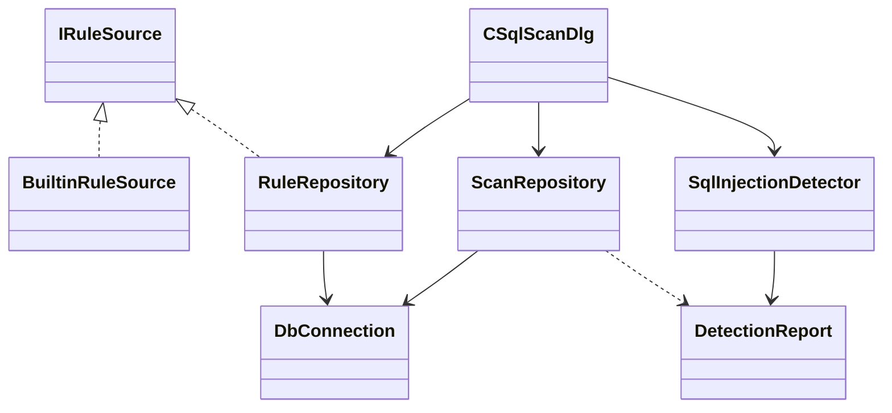
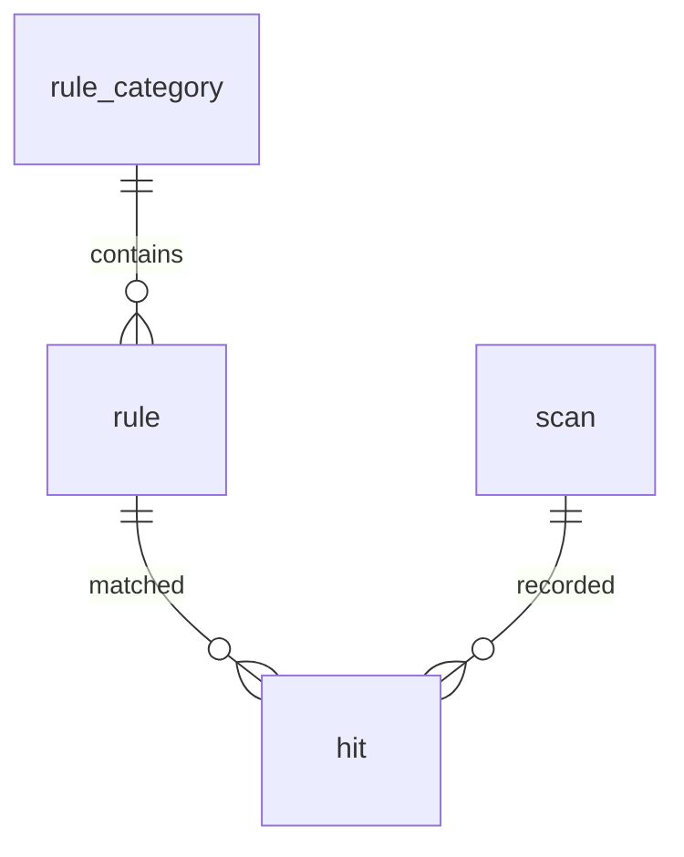

# Устройство SqlScan 2.0

## Поток проверки

1. Диалог принимает введённый текст либо читает файл с проверкой размера. У файла SHA-256 вычисляется по исходным байтам до преобразования кодировки. Ручной ввод хешируется в UTF-8.
2. `RuleRepository` загружает активные правила и настройки. При недоступной БД `BuiltinRuleSource` выдаёт исходный набор. Оба источника реализуют `IRuleSource`. Проверка использует снимок правил и порога.
3. `SqlInjectionDetector` ограничивает размер входа, разделяет физические строки, нормализует каждую и ищет все вхождения, включая перекрытия. В памяти хранятся первые 16 384 подробности. Если совпадений больше, движок сохраняет снимок правил и перечисляет детали при записи или экспорте тем же алгоритмом. Позиции измеряются в нормализованной строке. Три заводских сигнатуры допускают ограниченные варианты записи в своей категории. У совпадения сохраняется фактическая длина для подсветки. Режим совместимости с 1.0 сохраняет буквальный поиск, в том числе при повторном перечислении. [Подробности версии 2.0.2](DETECTION-2.0.2.md). Для одного короткого параметра без буквальных совпадений проверяются также два структурных признака логического условия. Вес и ID исходного правила сохраняются вместе с названием конкретного признака. [Разбор версии 2.0.3](DETECTION-2.0.3.md).
4. Окно показывает результат. Если есть подключение, `ScanRepository` записывает сводку и совпадения в одной транзакции. Пакеты до 500 совпадений передаются в PostgreSQL одним связанным параметром JSON на пакет. Ошибка откатывает всю запись.
5. Журнал, статистика и экспорт архивных проверок читают сохранённые сведения. Сбой сервера переводит следующую проверку на встроенные правила. Повторное подключение выполняется при следующем анализе.

## База и история

| Отношение | Что определяет первичный ключ |
|---|---|
| `rule_category` | Имя и описание категории |
| `rule` | Нормализованный шаблон, категорию, вес, риск, активность и даты изменения |
| `scan` | Время и источник проверки, хеш, размер, порог и итоговые показатели |
| `hit` | Проверку, правило, позицию, строку, контекст и значения, применённые в момент совпадения |
| `setting` | Значение именованной настройки |
| `whitelist` | Фрагмент и комментарий для последующего расширения |

Описание категории хранится однократно. Порог, применённый вес, шаблон, категория и флаг риска в событиях относятся к моменту анализа и могут отличаться от текущего правила. Индексы обслуживают выборки по времени, вердикту, хешу и внешним ключам совпадений. Одна проверка допускает несколько совпадений одного правила в разных позициях. Удаление проверки каскадное. Внешний ключ препятствует удалению правила, на которое ссылается история.

`db/schema.sql` создаёт шесть таблиц и начальные данные. `db/upgrade_2.sql` добавляет снимок категории и измерения отчёта. Для ранее записанных проверок отсутствующие измерения остаются NULL. Оба скрипта сериализуют инициализацию на уровне транзакции. Повторное выполнение сохраняет настройки, редакторские изменения и журнал. Приложение подготавливает запросы и DDL через SQLPrepareW. Внешние значения передаются связанными параметрами, ошибки ODBC сохраняют диагностику в исключении DbError. Имена сортируемых столбцов выбираются из фиксированного массива.

## Исходные файлы

| Файлы | Ответственность |
|---|---|
| `SqlInjectionDetector.h/.cpp` | Источник встроенных правил и движок на стандартном C++ |
| `Database.h/.cpp` | Соединение ODBC, репозитории сигнатур и журнала, настройки подключения через DPAPI |
| `SqlScanDlg.h/.cpp`, `SqlScan.rc` | Диалоги MFC, вкладки, диаграмма GDI, подсветка Rich Edit |
| `ReportIO.h/.cpp` | Кодировки, SHA-256, чтение файлов и экспорт с заменой готового файла |
| `Batch.cpp`, `SqlScan.cpp` | Выбор GUI или пакетного режима, чтение записей CSV с кавычками |
| `deploy/` | Первичная настройка и повторный запуск локального экземпляра Windows |

Пакетный режим анализирует полученный CSV локально. Проверки внешних целей и выполнение входного текста в SQL отсутствуют. При измерении качества libinjection запускается отдельно от приложения.
