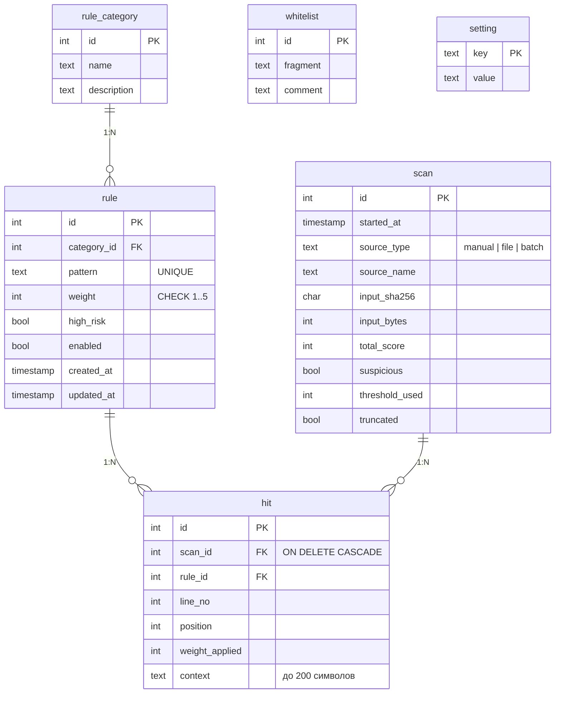

# Техническое задание: SqlScan 2.0

Доработка курсовой работы «Разработка GUI приложения на языке C++ для детекции простых SQL-инъекций» (Чураев А. А., ИБ-124, руководитель Колпаков А. А., МИ ВлГУ).

| | |
|---|---|
| Версия документа | 1.0 от 30.10.2026 |
| Базовая версия ПО | SqlScan 1.0 (тег `v1.0`) |
| Целевая версия ПО | SqlScan 2.0 |

---

## 1. Основание и исходная версия

**Что уже есть в SqlScan 1.0:**

- MFC-диалог на C++20: ввод строки или загрузка файла до 2 МБ (UTF-8 / ANSI), сохранение отчёта в UTF-8 с BOM.
- Сигнатурный движок `SqlInjectionDetector`: нормализация (регистр, пробелы), наивный поиск через `memcmp`, 18 правил с весами 1–5 и флагом «высокий риск», порог T = 5.
- Цветной отчёт в Rich Edit: подсветка опасных фрагментов, градиент суммы весов.
- Функциональное тестирование на 5 наборах данных.

**Чего нет — основа доработки:**

- Правила зашиты в конструктор — для изменения нужна пересборка.
- Результаты проверок нигде не хранятся: закрыл окно — история потеряна.
- Файл анализируется как одна строка, без разбивки по строкам журнала.
- Нормализация не снимает URL-кодирование и комментарии внутри ключевых слов (`UN/**/ION`).
- Качество обнаружения не сравнивалось с независимым эталоном.

## 2. Тема и цель

**Тема:** «Разработка GUI-приложения на языке C++ для детекции SQL-инъекций с хранением сигнатур и результатов анализа в реляционной базе данных».

**Цель:** превратить SqlScan из «одноразовой проверки строки» в рабочее место аналитика ИБ: сигнатуры редактируются без пересборки, каждая проверка сохраняется в БД, по истории можно искать и строить статистику, журналы веб-сервера разбираются построчно, а качество обнаружения подтверждено измерениями на независимых данных.

**Задачи:**

1. Спроектировать схему БД (ER-модель, нормализация до 3НФ) и написать DDL-скрипт с начальными данными.
2. Выделить слой доступа к данным (репозитории) между движком и интерфейсом.
3. Перенести таблицу сигнатур из кода в БД и сделать редактор правил.
4. Реализовать журнал проверок с поиском, фильтрами и статистикой.
5. Расширить движок: построчный анализ файлов, защита от простых обходов.
6. Оценить достоверность обнаружения на размеченных наборах данных и сравнить с эталонным детектором.

## 3. Требования к базе данных

БД хранит сигнатуры, историю проверок и настройки; без неё приложение только анализирует, но ничего не запоминает.

### 3.1 СУБД и способ подключения

- Рекомендуется **PostgreSQL** (или MS SQL Server Express) через **ODBC**: в MFC есть классы `CDatabase` / `CRecordset`, а ODBC API входит в Windows SDK — запрет на сторонние библиотеки не нарушается.
- Альтернатива — **SQLite** (один файл, без сервера), но это сторонний `sqlite3.c`; согласовать с руководителем.
- Параметры подключения (DSN или строка подключения) задаются в диалоге «Настройки БД» с кнопкой «Проверить соединение» и сохраняются в реестре HKCU (пароль — через DPAPI `CryptProtectData`, не открытым текстом).

### 3.2 Схема данных (3НФ)

| Таблица | Назначение |
|---|---|
| `rule_category` | Класс атаки: тавтология, UNION, комментарий, stacked queries, time-based, команды ОС, разведка схемы, DML |
| `rule` | Сигнатура; 18 правил из версии 1.0 — начальные данные |
| `scan` | Одна проверка (строка, файл или элемент пакета) |
| `hit` | Совпадение внутри проверки |
| `whitelist` | Исключения для снижения ложных срабатываний |
| `setting` | Порог T, лимиты размеров |

`weight_applied` в `hit` копирует вес на момент проверки, а `threshold_used` в `scan` — порог: если правило потом изменится, старые отчёты останутся верными. Удаление проверки каскадно удаляет её совпадения; правило с совпадениями не удаляется, а отключается (`enabled = false`).

### 3.3 Функции работы с БД

1. **Редактор сигнатур** (отдельная вкладка с `CListCtrl`): добавить, изменить, включить/отключить, удалить правило. Проверки: шаблон не пустой, до 64 символов, автоматически нормализуется, вес 1–5, без дублей. Детектор перечитывает правила без перезапуска.
2. **Автосохранение проверки**: `scan` + все `hit` записываются одной транзакцией (ошибка → ROLLBACK, анализ на экране не теряется).
3. **Журнал проверок**: таблица с фильтрами по периоду, вердикту, источнику, минимальному весу; сортировка по столбцам; постраничная загрузка (LIMIT/OFFSET); двойной щелчок — открыть сохранённый отчёт; удаление с каскадом.
4. **Дедупликация**: если файл с таким же SHA-256 уже проверялся — предложить показать прошлый результат (хеш через Windows CNG `BCryptHash`).
5. **Автономный режим**: БД недоступна → предупреждение в строке состояния, анализ работает на встроенном наборе из 18 правил.
6. **Инициализация**: при пустой БД приложение само создаёт таблицы и заполняет начальные данные; тот же скрипт `db/schema.sql` лежит в репозитории.

### 3.4 Безопасность работы с БД

- Все запросы — **только параметризованные** (`SQLPrepare` + `SQLBindParameter`); конкатенация пользовательских данных в SQL запрещена. Детектор SQL-инъекций сам сохраняет в БД вредоносные строки — он обязан быть к ним неуязвим.
- Отдельная учётная запись СУБД с правами только на свою схему (принцип наименьших привилегий).
- Исходный текст проверки целиком в БД не хранится (только хеш, размер и фрагменты совпадений до 200 символов) — журналы могут содержать персональные данные.

## 4. Улучшения помимо БД

| № | Улучшение | Что именно | Зачем | Приоритет |
|---|---|---|---|---|
| 1 | Построчный анализ журналов | Файл делится на строки, каждая оценивается отдельно; в отчёте — номер строки и вердикт по ней | Сейчас весь лог — одна строка, и не видно, какой запрос атакующий | Обязательно |
| 2 | Расширенная нормализация (антиобход) | URL-декодирование `%27`, `+`, двойное кодирование; HTML-сущности `&#39;`; удаление `/**/` внутри слов (`UN/**/ION`) | В отчёте 1.0 обход мутацией назван главным недостатком метода | Обязательно |
| 3 | Категории атак и уровни риска | Вместо ДА/НЕТ — «Низкий / Средний / Высокий / Критический»; в отчёте — класс атаки | Аналитик сразу видит тип угрозы; использует `rule_category` | Обязательно |
| 4 | Статистика с диаграммами | Число проверок по дням, доля подозрительных, топ-10 сработавших правил; диаграммы рисуются GDI | Показывает ценность БД: запросы с GROUP BY, JOIN, агрегатами | Обязательно |
| 5 | Экспорт отчётов | CSV (для Excel) и HTML (с цветной подсветкой) для одной проверки и выборки из журнала | В 1.0 только TXT без цвета | Обязательно |
| 6 | Метрики качества и модульные тесты | Microsoft Native Unit Test для детектора и репозиториев; precision, recall, F1 на размеченной выборке | Вместо «тест пройден» — измеренное качество (см. раздел 7) | Обязательно |
| 7 | Пакетная проверка в фоне | Несколько файлов или папка; анализ в рабочем потоке (`std::jthread`), прогресс-бар, «Отмена» | Интерфейс не зависает | По желанию |
| 8 | Алгоритм Ахо — Корасик | Один проход по тексту для всех шаблонов: O(n + m + k) вместо O(R·n·m); замер «до/после» | Правил из БД станет больше 18 | По желанию |
| 9 | Белый список | Фрагменты из `whitelist` исключаются из оценки; в отчёте помечаются серым | Снижает ложные срабатывания | По желанию |
| 10 | Роли пользователей | Таблица `app_user`: Администратор редактирует правила, Аналитик только проверяет; пароль — PBKDF2 с солью (CNG) | Контроль доступа — тема ИБ, но заметно увеличивает объём | По желанию |

**Интерфейс:** единственный диалог 1.0 становится главным окном с вкладками (`CTabCtrl`) «Проверка», «Журнал», «Сигнатуры», «Статистика», меню и строкой состояния (подключение к БД, число активных правил).

## 5. Нефункциональные требования и технологии

Ограничения версии 1.0 сохраняются: C++20, MFC, Visual Studio 2022+, x64, без `std::regex` и без .NET.

| Параметр | Требование |
|---|---|
| Доступ к БД | ODBC 3.x (`sql.h`, `odbc32.lib`) или MFC `CDatabase`; драйвер psqlODBC / ODBC Driver for SQL Server |
| Архитектура | Три слоя: движок (`SqlInjectionDetector`, без MFC) → данные (`DbConnection`, `RuleRepository`, `ScanRepository`) → интерфейс. Интерфейс `IRuleSource` с двумя реализациями (БД / встроенные правила) |
| Ресурсы | RAII-обёртки над `SQLHENV` / `SQLHDBC` / `SQLHSTMT`; ошибки ODBC → исключение `DbError` с текстом из `SQLGetDiagRec` |
| Производительность | Анализ 512 КБ — не дольше 100 мс; сохранение проверки с 1 000 совпадений — не дольше 1 с (вставка в одной транзакции); журнал из 10 000 записей открывается за 1 с (индексы по `started_at`, `suspicious`, `scan_id`) |
| Надёжность | Потеря соединения не роняет приложение: сообщение + попытка переподключения; все защиты 1.0 (лимиты, BOM, нулевые байты, ACP) сохраняются |
| Развёртывание | `SqlScan.exe` + `db/schema.sql` + инструкция по установке СУБД и настройке DSN; права администратора для самого приложения не нужны |

## 6. Пояснительная записка, тестирование, график

### 6.1 Структура ПЗ

1. Анализ ТЗ (+ обзор и выбор СУБД, сравнение ODBC / встраиваемой БД; версия 1.0 как исходные данные)
2. **Проектирование БД** (новый раздел: инфологическая модель, ER-диаграмма, нормализация до 3НФ, DDL, индексы, типовые запросы)
3. Разработка алгоритмов (+ расширенная нормализация, построчный анализ, сохранение в транзакции; блок-схемы; UML-диаграмма классов)
4. Руководство программиста (+ установка СУБД, DSN, развёртывание схемы)
5. Руководство пользователя (+ вкладки «Журнал», «Сигнатуры», «Статистика», настройки БД)
6. Тестирование и оценка достоверности (см. 6.2 и раздел 7)

Графический материал: блок-схемы, ER-диаграмма, диаграмма классов, снимки окон.

### 6.2 Тестирование

- Пять наборов 1.0 — как регрессионные (результат не должен измениться).
- БД: CRUD правил, нарушение CHECK/UNIQUE, каскадное удаление, откат транзакции, работа при остановленной СУБД.
- Безопасность: сохранение строки `'; DROP TABLE scan; --` в журнал не должно ничего сломать.
- Обходы: `%27%20OR%201%3D1`, `UN/**/ION SEL/**/ECT`, `&#39; or` — в 1.0 не ловятся, в 2.0 должны.
- Производительность: журнал из 10 000 проверок (сгенерировать скриптом).

### 6.3 Календарный график

| Этап | Готовность | Неделя |
|---|---|---|
| Анализ ТЗ, выбор СУБД | 10% | 2 |
| Проектирование БД, DDL | 25% | 4 |
| Слой данных, сохранение проверок | 40% | 7 |
| Журнал, редактор сигнатур | 55% | 9 |
| Расширение движка, статистика, экспорт | 70% | 12 |
| Тестирование, оценка достоверности, отладка | 85% | 14 |
| Оформление пояснительной записки | 100% | 15 |

## 7. Оценка достоверности обнаружения

Доверие к вердиктам доказывается не сертификатом (сертификация ФСТЭК — для коммерческих СЗИ), а проверкой на независимых размеченных данных и сравнением с признанным детектором; результат должен воспроизводиться одной командой.

1. **Независимые наборы данных**: CSIC 2010 HTTP Dataset, SQL Injection Dataset (Kaggle), HttpParamsDataset (GitHub); нагрузки из PayloadsAllTheThings и SecLists — для проверки полноты. Версия и источник набора фиксируются в записке.
2. **Эталонный детектор**: libinjection (основа SQLi-защиты ModSecurity), дополнительно — правила OWASP CRS 942xxx. Используются только в тестовом стенде, в продукт не входят.
3. **Метрики**: матрица ошибок (TP, FP, TN, FN), precision, recall, FPR, F1 — для SqlScan 1.0, SqlScan 2.0 и libinjection на одних и тех же данных; дополнительно recall по категориям атак.
4. **Воспроизводимость**: консольный режим `SqlScan.exe --batch dataset.csv --out result.csv` + скрипт подсчёта метрик в каталоге `benchmark/`.
5. **Анализ ошибок**: разбор пропусков и ложных срабатываний по классам, честное описание ограничений сигнатурного метода (инструмент первичного отсева, а не доказательство атаки).

**Критерий приёмки:** SqlScan 2.0 по F1 не хуже 1.0 на том же наборе; целевые значения фиксируются после первого замера версии 1.0.
